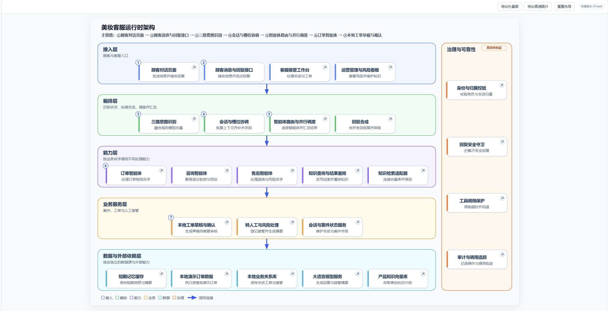
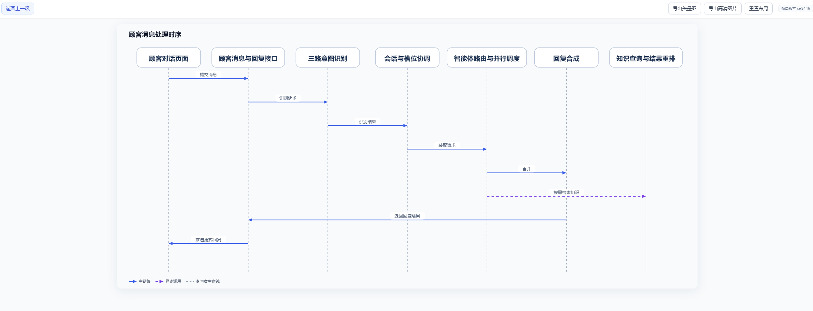
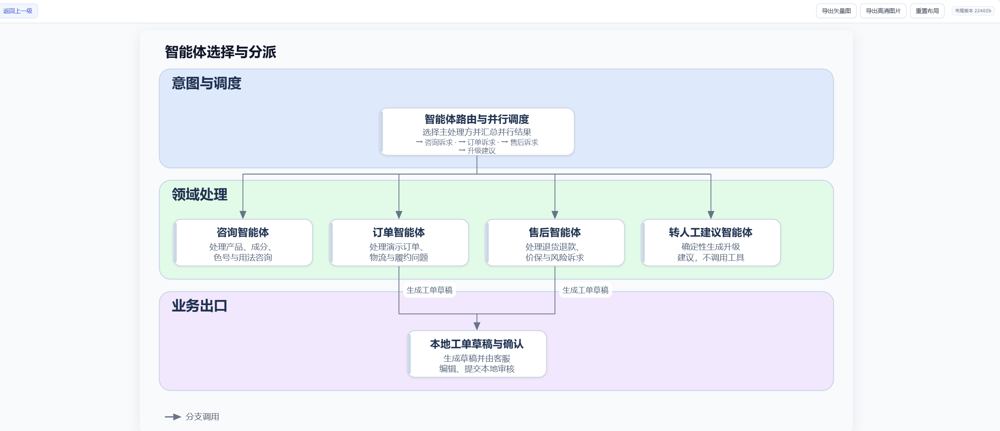

<div align="center">

# PyArchTrace

### 把 Python 代码，讲成看得懂、点得开的架构图

[简体中文](README.md) · [English](README_EN.md)


**用自然语言描述你想看的系统，PyArchTrace 帮你从 Python 源码整理出架构、时序与业务链路。**

</div>

先看整体，再点开关键模块看里面怎么工作。生成的图有源码依据，可在浏览器中拖动、下钻，并导出为 SVG 或 PNG。

<p align="center"><b>描述目标 → 确认结构 → 查看交互图</b></p>

## 从整体到细节

### 运行时架构：系统由哪些部分组成？

按项目代码中的真实职责分层，展示入口、流程编排、具体能力、业务服务与数据等模块。治理类职责放在侧边；不存在的层不会为了套模板而补出来。

<p align="center">
  
</p>
<p align="center"><sub>运行时架构总览 · 看清模块分层与治理侧栏</sub></p>

### 消息时序：一次请求经过了什么？

时序图按时间向下展开参与者之间的消息，适合梳理从用户输入、系统处理到结果返回的过程。

<p align="center">
  
</p>
<p align="center"><sub>消息处理时序 · 顺着时间线读懂请求与回复</sub></p>

### 模块下钻：这个职责内部如何分支？

在总图中打开模块，可以继续查看内部步骤、并行分支和业务出口；逐级返回后仍保留整体上下文。

<p align="center">
  
</p>
<p align="center"><sub>调度链路下钻 · 展开分支并查看各自的处理出口</sub></p>

## 直接用自然语言调用

不需要先写 JSON、手工摆坐标或设计箭头。告诉 Skill 项目位置、想看的链路和关注重点即可；它先整理结构给你确认，收到确认后再生成最终图。

**生成项目架构总览**

```text
使用 `$architecture-diagram` 阅读当前 Python 项目，按代码里的真实职责整理运行时架构。先给我模块分层和主链路确认，等我确认后再生成可交互图。
```

**追踪一条端到端请求**

```text
使用 `$architecture-diagram` 把“用户提交查询到结果返回”画成时序图，重点展示请求经过的模块、调用的能力和数据读写。
```

**打开模块内部细节**

```text
在架构总图中为“知识检索”模块生成下钻图，展开查询构造、召回、排序和结果返回之间的关系。
```

**限定分析范围**

```text
只分析在线请求主链路；跳过测试、离线评测和部署文件。关系以 Python 源码能确认的内容为准。
```

你也可以直接说“只看订单处理”“重点解释转人工链路”或“再把意图识别展开”，让图聚焦在当前最关心的问题上。

## 图生成后可以做什么

- **三种视图**：运行时架构图、时序图、端到端链路图。
- **交互下钻**：从总览进入模块内部关系，查看分支，再返回上一级。
- **自由调整**：拖动模块，相关箭头会跟随更新；可一键恢复自动布局。
- **方便分享与二次编辑**：导出清晰 PNG 或 SVG；单文件 HTML 可离线打开。
- **回到代码核对**：模块与关系可以追溯到对应源码位置，便于理解和复查。

## 快速开始

需要 Python 3.10 或更高版本。推荐用下面两条命令安装：第一条安装分析与渲染 CLI，第二条把 Skill 安装到 Codex。第二条需要 Node.js 22.20 或更高版本提供 `npx`。

```powershell
python -m pip install "git+https://github.com/sheily899/PyArchTrace.git"
npx skills add sheily899/PyArchTrace --skill architecture-diagram --global --agent codex --yes
```

安装后，在 Codex 中用自然语言提出任务，例如：

```text
使用 $architecture-diagram 阅读当前 Python 项目，先给我确认模块分层和主链路，再生成可交互架构图。
```

如果只需要命令行工具，可只执行第一条命令。若要从源码参与开发，再克隆仓库并安装开发依赖：

```powershell
git clone https://github.com/sheily899/PyArchTrace.git
cd PyArchTrace
python -m pip install -e ".[dev,browser]"
```

浏览器截图需要本机安装 Chrome 或 Edge。Skill 当前生成中文图中文字；英文版 README 方便更多开发者了解和安装。

更新到最新版：

```powershell
python -m pip install --upgrade "git+https://github.com/sheily899/PyArchTrace.git"
npx skills update architecture-diagram --global --yes
```

CLI 项目盘点示例：

```powershell
architecture-diagram scan D:\my-python-project -o D:\my-python-project\docs\architecture-diagram\facts.json
```

## 适用范围

- 当前面向 **Python 项目**；混合语言仓库只分析 Python 子系统。
- 工具不会导入或执行待分析项目。动态导入、反射和配置驱动的关系可能无法被静态扫描完整发现。
- Python 代码提供导航线索；模块职责和调用关系仍以阅读源码后的证据为准。

## 延伸阅读

[Skill 使用说明](SKILL.md) · [源码分析流程](references/analysis-stages.md) · [布局规则](docs/layout-contract-v2.md) · [关系图路由](docs/edge-group-routing.md) · [时序图示例](examples/sequence-demo.json)

## 许可

本项目采用 [MIT 许可证](LICENSE)，版权标注为 `sheily899`。你可以使用、修改和再发布本项目，但需保留版权与许可声明。
